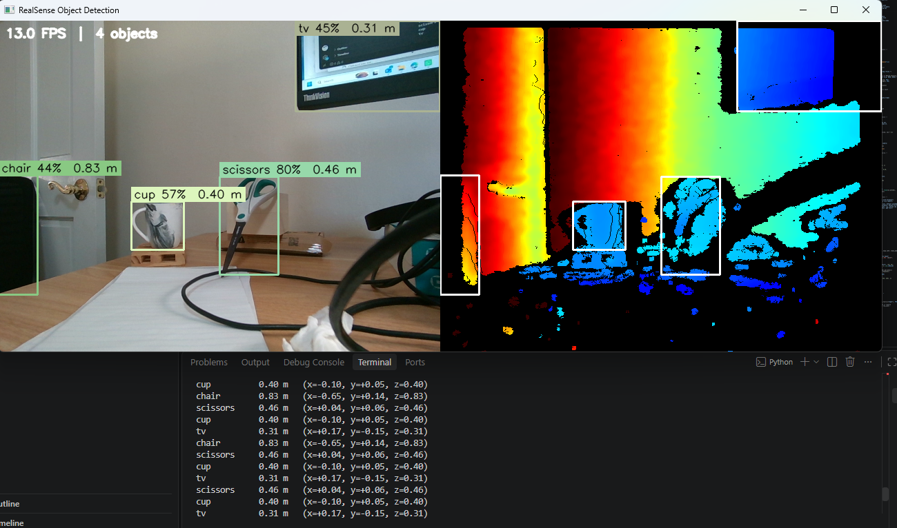

# RealSense Object Detection with Distance

Detects objects in real time with an Intel® RealSense™ depth camera and shows **what** each object is and **how far away** it is, in meters, along with its 3D position relative to the camera.


> **AI-assisted project.** I built this with Claude, basing it on the official [librealsense Python examples](https://github.com/realsenseai/librealsense/tree/master/wrappers/python/examples) from the RealSense SDK I managed for eleven years at Intel.

## How it works
1. Streams color and depth from the camera, or plays back a recorded `.bag` file
2. Aligns depth to color (`rs.align`, as in `align-depth2color.py`), so every pixel in the color image has a matching depth value
3. Runs a YOLO model on the color image to find objects (80 everyday classes: people, cups, chairs, laptops, …)
4. For each object, takes the **median depth of the central part of its bounding box**, ignoring missing depth and background at the box edges, and converts it to meters
5. Uses the camera intrinsics (`rs2_deproject_pixel_to_point`) to get the object's 3D position (x, y, z)

The window shows the annotated color image next to the colorized depth view.

## Run it
Works with D400-series cameras that have a color sensor (e.g. D415, D435, D455).

```bash
pip install -r requirements.txt
python realsense_object_detection.py                       # live camera
python realsense_object_detection.py --bag recording.bag   # recorded file
python realsense_object_detection.py --classes person cup  # only these objects
python realsense_object_detection.py --conf 0.5 --save out.mp4
```

The YOLO model (`yolov8n.pt`) downloads automatically on first run. Use `--model yolov8s.pt` for a more accurate but slower model.

**Keys:** `q`/`Esc` quit · `d` show/hide depth view · `s` save a snapshot

## Notes
- Distance is the median over the center of the box, so it reads the object rather than whatever is behind it. Very thin or hollow objects can still pick up background depth.
- Object detection uses [Ultralytics YOLO](https://github.com/ultralytics/ultralytics), which is licensed under AGPL-3.0.

**Tech:** Python · pyrealsense2 (RealSense SDK 2.0) · Ultralytics YOLO · OpenCV · NumPy
